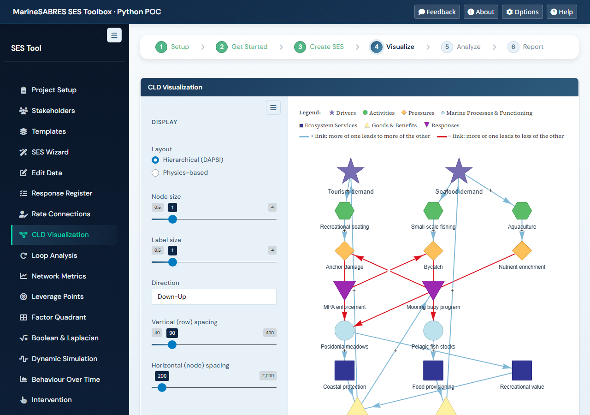

# SESPy app — MarineSABRES SES Toolbox · Python research UI

[](https://github.com/razinkele/sespy-app/actions/workflows/ci.yml)
[](LICENSE)


The Shiny-for-Python research UI of the [MarineSABRES SES Toolbox](https://marinesabres.eu)
port. It builds causal loop diagrams of marine social-ecological systems typed
with DAPSI(W)R(M), then analyses them: feedback loops, leverage points,
governance gaps, cascades, dynamic simulation, interventions, reports.

This repository is the **app only**. The analysis code, data structures,
translations, templates and reference data live in the
[`sespy` library](https://github.com/razinkele/SESPy), which the app installs
from a pinned tag (see `pyproject.toml`; currently `v1.18.0`). The app was
split out of `razinkele/SESPy` at v1.17.1 and restarted its own version line at
1.0.0. The R app remains the source of truth for behaviour and schema.

The user manual is [`docs/MANUAL.md`](docs/MANUAL.md), also shown in the app
under About → Manual. About displays both versions: the app and the library.



## Layout

| Path | What |
|---|---|
| `app.py` | Shiny app entry point |
| `sespy_app/` | UI package: `modules/` (one per panel), `dashboard`, `event_bus`, `i18n` (reactive translator), `kb_reads`, `browser_token`, `feedback_store`, `www/` |
| `tests/` | unit tests and standalone Playwright e2e scripts (`run_e2e.py` runs them) |
| `deploy/` | `deploy.sh` for the laguna server |
| `data/`, `www/` | sample projects and static assets |

## Install

The full app needs the pyvis 4.x fork (`pyvis.shiny`), so the easiest route is
the conda environment:

```bash
micromamba env create -f environment.yml
micromamba activate sespy
pip install -e .[test]      # installs sespy_app and the sespy library from its pinned git tag
```

Plain pip works too (`pip install -e .`); the fork comes from PyPI as
`pyvis-optimized`. Never `pip install pyvis` into an environment that has the
fork: pip would overwrite it with upstream 0.3.x, which has no `.shiny`.

For development against an unreleased library, put the library checkout on
`PYTHONPATH` instead of installing it (and never have the old monolith
`SESPy` checkout, which still contains `sespy.modules`, on the path; the test
suite refuses to run if it is).

## Run

```bash
shiny run --port 8000 app.py
# open http://127.0.0.1:8000
```

## Test

```bash
# Unit tests (the browser scripts need a live server and are excluded)
pytest tests/ -q --ignore-glob='*e2e*' --ignore=tests/test_burger.py \
  --ignore=tests/test_stepper.py --ignore=tests/test_stepper_click.py

# Full Playwright e2e: boots the server, runs every browser script, handles
# the wizard's ANTHROPIC_API_KEY two-pass
python tests/run_e2e.py
```

`tests/run_e2e.py` prints which `sespy` the server will import (file, version,
and whether `sespy.modules` exists), so a run against the wrong library
checkout is visible. CI runs lint (ruff, non-blocking mypy), unit tests on
Python 3.11/3.12, a conda full-app job and the e2e suite.

## Documentation images

```bash
python tests/make_docs_screenshots.py --port 8000    # needs a server on :8000
```

Bump the version line in `docs/MANUAL.md` and rerun this each release.

## Changelog

[`CHANGELOG.md`](CHANGELOG.md). From 1.0.0 it is the app's changelog; entries
before 1.0.0 are the monolith SESPy's.

## License

MIT, see [`LICENSE`](LICENSE).
